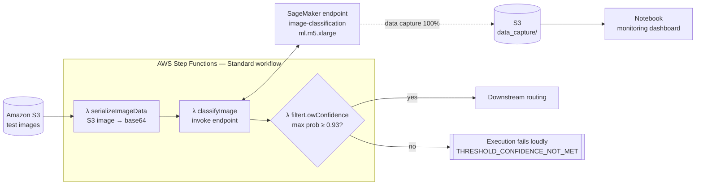
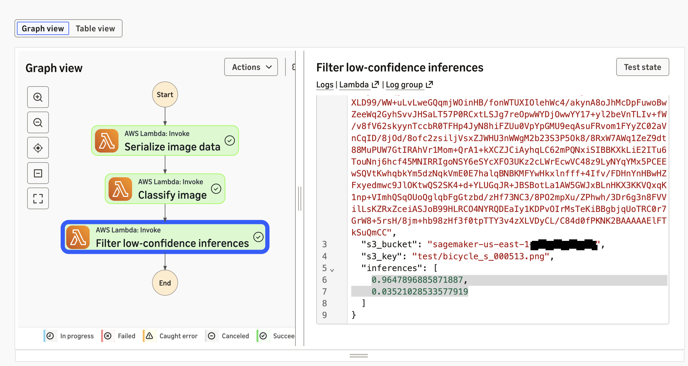
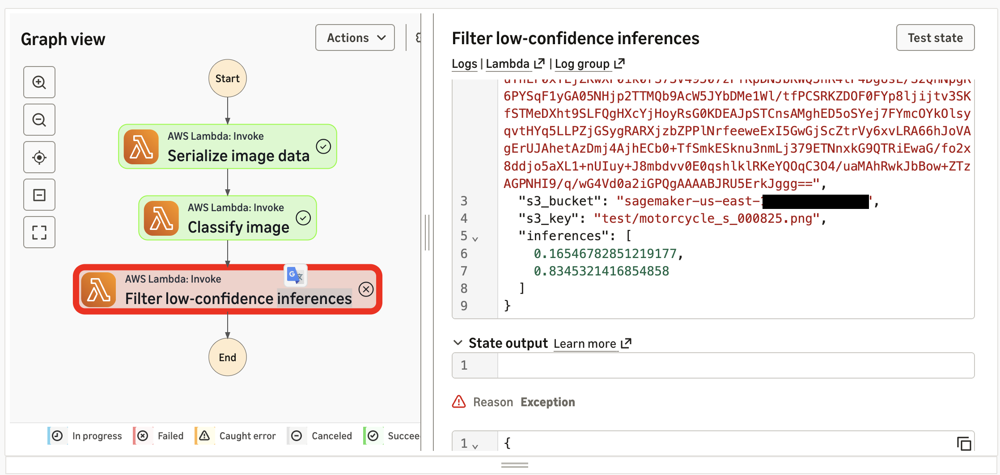
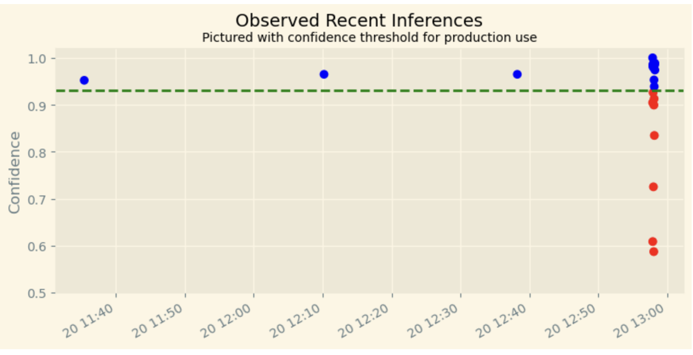
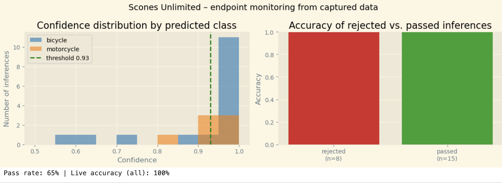

# Scones Unlimited — Event-Driven Image Classification on AWS

An end-to-end ML workflow on **Amazon SageMaker, AWS Lambda and AWS Step Functions** that classifies delivery vehicles (**bicycle vs. motorcycle**) so drivers can be routed automatically: bicycles to nearby orders, motorcycles to orders farther away.

> Udacity *AWS Machine Learning Engineer* Nanodegree — project "Build a ML Workflow for Scones Unlimited on Amazon SageMaker".

---

## Architecture



| Component | Role |
|---|---|
| **S3** | stores training/test images, `.lst` manifests, model artifacts and captured inferences |
| **SageMaker training job** | built-in *Image Classification* algorithm (ResNet), GPU instance |
| **SageMaker endpoint** | real-time inference with **data capture** enabled |
| **Lambda 1 – `serializeImageData`** | downloads the image from S3 and base64-encodes it (JSON-safe) |
| **Lambda 2 – `classifyImage`** | decodes the image and calls the endpoint (`boto3` `invoke_endpoint`) |
| **Lambda 3 – `filterLowConfidence`** | passes the result only if confidence ≥ threshold, otherwise raises an error |
| **Step Functions** | chains the three Lambdas; no error handling on the last state so failures are visible to operations |

---

## Workflow

### 1. Data staging (ETL)
- **Extract:** CIFAR-100 (python version) from the University of Toronto.
- **Transform:** kept fine labels **8 (bicycle)** and **48 (motorcycle)** → 1,000 training and 200 test images; each 3,072-value row reshaped to a 32×32×3 RGB array and saved as PNG.
- **Load:** images synced to `s3://<bucket>/train/` and `s3://<bucket>/test/`; `train.lst` / `test.lst` manifests (`index  label  path`, labels 0 = bicycle, 1 = motorcycle) uploaded for the algorithm.

### 2. Model training and deployment
- Algorithm: SageMaker built-in **image-classification**, hyperparameters `image_shape=3,32,32`, `num_classes=2`, `num_training_samples=1000` (defaults otherwise, 30 epochs).
- Four input channels: `train`, `validation`, `train_lst`, `validation_lst` (*image + lst* format).
- Instance: **`ml.g4dn.xlarge`** (546 billable seconds).
- **Validation accuracy ≈ 0.83** (target > 0.8).
- Deployed to an `ml.m5.xlarge` endpoint with **`DataCaptureConfig` at 100% sampling**.
- Sanity check: `test/bicycle_s_001789.png` → `[0.952, 0.048]` (bicycle).

### 3. Lambda functions and Step Functions
- Code for all three functions: [`lambda.py`](lambda.py) (each deployed separately as `lambda_handler`, Python 3.12).
- State machine definition: [`step_function.json`](step_function.json). Each task uses `"OutputPath": "$.Payload.body"` so every Lambda receives the same data object:

```json
{ "image_data": "<base64>", "s3_bucket": "<bucket>", "s3_key": "test/...png", "inferences": [p_bicycle, p_motorcycle] }
```

- Transient Lambda errors are retried on the first two states; the filter state has **no retry/catch**, so low confidence ends the execution as **Failed**.

| Successful execution | Failed execution (low confidence) |
|---|---|
|  |  |

### 4. Testing and monitoring
- 20+ executions launched from the notebook with a random test-image generator (also a simple *dummy-data generator*).
- Captured JSONL records were downloaded from S3 and parsed (all files in the date-partitioned folders, every line per file).
- **Ground truth recovered for captured inputs**: each captured image is matched to its test file by MD5 fingerprint, and the true label is read from `test.lst`. This turns the capture data into **model-quality monitoring**, not just confidence monitoring.




**Results (23 captured inferences):**

| Metric | Value |
|---|---|
| Pass rate at threshold 0.93 | **65 %** |
| Live accuracy (all captured inferences) | **100 %** |
| Rejected predictions that were actually correct | **all of them** in this sample |

**Interpretation.** On this small sample the 0.93 threshold rejected about a third of the traffic even though every rejected prediction was correct, i.e. it added manual-review work without preventing a single error. The sample is small and contains repeated images, so 100 % accuracy will not hold in general (validation accuracy is ≈ 0.83). The threshold should therefore be chosen from more labelled live data, e.g. the lowest threshold that keeps the accuracy of *passed* predictions ≥ 95 %, trading routing errors against review workload.

---

## Practical issues solved

| Issue | Fix |
|---|---|
| SageMaker Studio ships Python SDK **v3**; the course code is v2 | pinned `sagemaker>=2.250,<3` in the notebook |
| `ml.p3.2xlarge` no longer available for training in us-east-1 | trained on `ml.g4dn.xlarge` (cheaper, same accuracy target met) |
| `image_uris.retrieve(..., version="latest")` rejected | default image version |
| Lambda runtime Python 3.8 retired | Python 3.12 |
| Lambda 1 returned base64 **bytes** → not JSON-serializable | `.decode("utf-8")` |
| SageMaker SDK not available in Lambda | `boto3` `sagemaker-runtime.invoke_endpoint` in Lambda 2 |
| `raise("...")` is invalid Python | `raise Exception("THRESHOLD_CONFIDENCE_NOT_MET")` |
| Test generator `objects.filter("test")` | `objects.filter(Prefix="test/")` |
| Capture loader read only the first record of top-level files | recursive glob + read every JSONL line |
| CIFAR file names use synonyms (`velocipede`, `minibike`, …) | true labels taken from `test.lst`, not file names |
| SageMaker **Model Monitor** schedules and **Clarify** jobs are closed to new AWS accounts | monitoring built directly on captured data in the notebook |

---

## Repository structure

```
├── starter.ipynb          # completed notebook with outputs (ETL, training, deployment, testing, monitoring)
├── lambda.py              # the three Lambda functions
├── step_function.json     # exported Step Functions definition
├── screenshots/           # working / failing executions, monitoring charts
└── README.md
```

## How to reproduce
1. Open `starter.ipynb` in SageMaker Studio (Python 3 kernel, `ml.t3.medium`), install SageMaker SDK v2 (first cell), run the ETL and training sections.
2. Deploy the endpoint, update `ENDPOINT` in Lambda 2, create the three Lambdas (Python 3.12) with a role allowing S3 read, `sagemaker:InvokeEndpoint` and CloudWatch Logs.
3. Create a Standard state machine from `step_function.json`.
4. Run the testing cells to launch executions and build the monitoring charts.
5. **Clean up:** delete the endpoint; stop the Studio space.

## Possible extensions
- More CIFAR-100 vehicle classes (bus, pickup truck, train …).
- Parallel processing of image batches with a Step Functions **Map** state.
- Alerting on failed executions (EventBridge rule → SNS).
- Automated threshold selection from a precision vs. rejection-rate curve.
